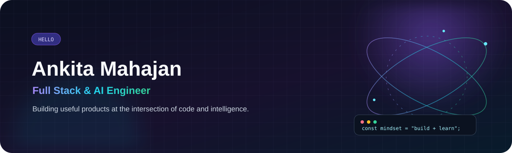
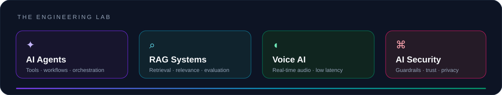
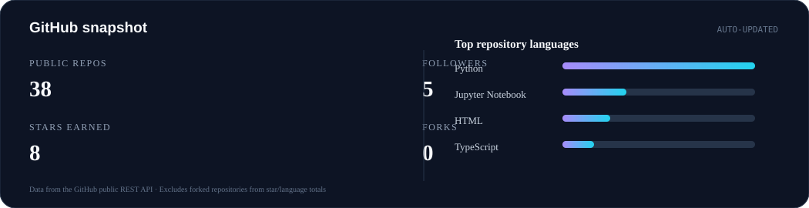
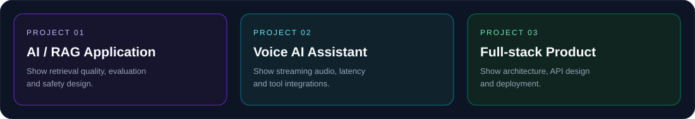

 

## `whoami`

I'm **Ankita Mahajan**, a Full Stack & AI Engineer who enjoys turning complex problems into useful, reliable products.

- Building thoughtful full-stack applications and AI-powered experiences.
- Exploring LLM applications, RAG, AI agents, voice interfaces and secure tool use.
- Interested in clean architecture, developer experience and systems that scale.

> **My approach:** make it useful, make it understandable, make it dependable.

## `currently_exploring`

  

## `toolbox`

### Languages & backend

### Frontend & data

### Cloud, DevOps & AI

## `github_activity`

 

## `featured_work`

> Replace these starter cards with your strongest public repositories. Pin the same projects on your GitHub profile.

  

| Project | What to highlight |
|---|---|
| **AI / RAG application** | Problem solved, retrieval strategy, evaluation and guardrails |
| **Voice AI assistant** | Real-time audio flow, orchestration, latency and integrations |
| **Full-stack product** | Architecture, APIs, data model, testing and deployment |

## `a_little_more`

- I like learning by building and explaining systems simply.
- I value readable code, thoughtful trade-offs and secure-by-default design.
- Always curious about what can be made simpler, faster and more useful.

**Let's build something meaningful.**

Designed with care · Stats and contribution art refresh automatically with GitHub Actions

